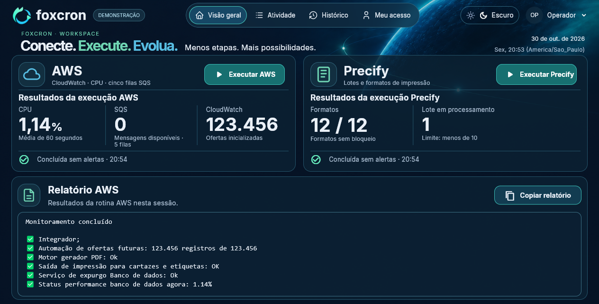

# Foxcron Desktop

**Conecte. Execute. Evolua.** Rotinas AWS e Precify para o NOC, com login/MFA automáticos, histórico e relatório AWS para copiar.

## Instalar no Windows

1. [Baixe o ZIP da versão atual](https://github.com/FoxStrife/FoxcronDesktop-Releases/releases/latest).
2. Extraia todo o ZIP em uma pasta.
3. Execute **Instalar Foxcron.cmd** e aguarde os downloads.
4. Abra pelo atalho **Foxcron** na Área de Trabalho.

Windows 10/11 x64 e internet são necessários. O script instala no seu usuário, usa Python x64 existente ou tenta obtê-lo pelo winget, e baixa bibliotecas, Chromium e a CLI Bitwarden oficial. Se winget não estiver disponível, instale Python x64 de [python.org](https://www.python.org/downloads/windows/) com pip e launcher e execute o script novamente. Não requer Git ou conta GitHub.

A instalação ocupa mais espaço depois dos downloads. Políticas do Windows ou da empresa ainda podem bloquear scripts; o processo não altera políticas permanentes de segurança.

## Primeiro uso

Em **Meu acesso**, configure AWS, Vaultwarden/Bitwarden e Precify com suas credenciais nominais. Para login/MFA mais rápido, importe o item do cofre em **Cópia local protegida**.

Na **Visão geral**, execute AWS ou Precify. Acompanhe e cancele em **Atividade**; consulte verificações anteriores em **Histórico**. Uma rotina é executada por vez.

O relatório usa apenas ofertas e CPU válidas da sessão AWS atual. Alertas de contagem SQS não bloqueiam a cópia; falhas, incompletude e cancelamento bloqueiam.

## Atualizações

O menu **Operador** mostra **Atualizar para …** somente quando detecta uma versão estável mais nova. A verificação ocorre ao abrir e periodicamente; ficar sem internet não bloqueia as rotinas. A atualização é iniciada por você, com o app ocioso.

O pacote é verificado por SHA-256 e preparado em outra pasta. A versão ativa só muda após instalar as dependências. Cadastros, cofre e histórico são preservados. Cada release publicada é uma atualização; commits isolados não são instalados automaticamente.

## Ajuda

[Instalação e atualização](docs/INSTALLATION.md) · [Configurar o cofre](docs/BITWARDEN_SETUP.md) · [Modo rápido](docs/FAST_ACCESS.md) · [Guia de uso](docs/USER_GUIDE.md) · [Problemas comuns](docs/TROUBLESHOOTING.md)

AWS é consultada somente pela API, sem consumir ou alterar mensagens SQS. O navegador interno autentica o SSO e executa Precify. O ambiente monitorado é específico de Pague Menos; cada operador precisa das permissões correspondentes.

Senhas, tokens e TOTP são protegidos no cofre do Windows. Não compartilhe banco ou sessões com outro operador. O ZIP contém o código Python necessário à execução; não contém dados pessoais ou materiais administrativos.
