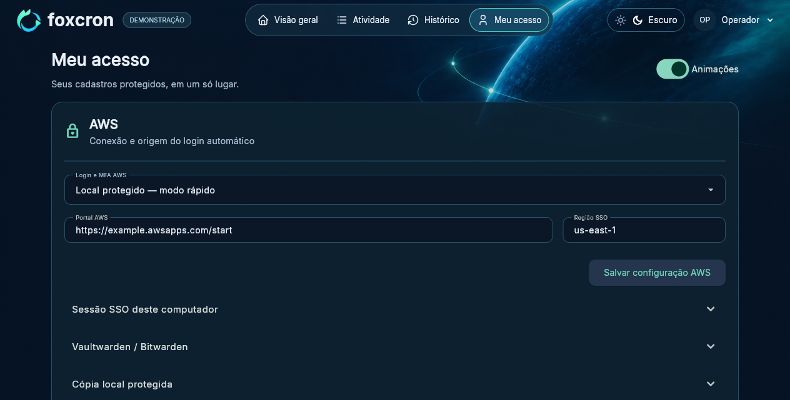

# Configurar Vaultwarden / Bitwarden

O cadastro é feito pela interface do Foxcron. Não é necessário descobrir UUID de item, copiar sessão CLI ou digitar MFA a cada execução normal.

## Preparar o item AWS

No seu cofre, mantenha um item de login com:

- Nome único e exato, por exemplo `AWS NOC`.
- Usuário do portal AWS.
- Senha do portal AWS.
- Configuração TOTP do autenticador, capaz de gerar os códigos aceitos pela AWS.

O aplicativo procura o nome exato, incluindo espaços e maiúsculas. Havendo dois itens com o mesmo nome, a conexão é recusada para evitar escolher a credencial errada. Um item contendo somente TOTP não atende ao fluxo completo desta interface.

## Obter a CLI

Baixe a CLI Windows no [site oficial do Bitwarden](https://bitwarden.com/help/cli/), extraia `bw.exe` e guarde-o em uma pasta local. É possível colocá-lo na raiz do projeto, onde o Foxcron tenta localizar o arquivo automaticamente, ou informar seu caminho completo em tela.

O executável não é distribuído no repositório. Não use o caminho do aplicativo gráfico Bitwarden: o campo espera a CLI `bw.exe`.

## Configurar no Foxcron

1. Abra **Meu acesso → AWS**.
2. Em **Portal AWS**, informe a URL `https://...awsapps.com/start` fornecida pela organização. Informe a **Região SSO** do IAM Identity Center e clique em **Salvar configuração AWS**.
3. Expanda **Vaultwarden / Bitwarden**.
4. Preencha **Servidor HTTPS do cofre**, **E-mail do cofre**, **Senha mestra**, **Nome exato do item AWS** e **Caminho da CLI bw.exe**.
5. Para permitir novo desbloqueio automático do cofre, mantenha **Proteger senha mestra no cofre deste computador** marcado. A senha mestra passa a ser protegida no cofre nativo do Windows. Sem essa opção, uma sessão vencida/bloqueada pode exigir informar a senha novamente.
6. Clique em **Conectar ao cofre** e aguarde a confirmação. Se necessário, abra **Atividade** para acompanhar as etapas.
7. Escolha **Vaultwarden / Bitwarden** no seletor **Login e MFA AWS** e salve a configuração.

Use o endereço HTTPS do servidor da sua conta, confirmado pelo administrador do cofre. Vaultwarden e Bitwarden oficial podem usar servidores diferentes; não troque para outro serviço apenas porque o nome do programa é semelhante. Não use URLs que incluam senha ou token.

O aplicativo mantém um perfil de CLI separado por servidor e e-mail. Não troca silenciosamente uma sessão identificada como pertencente a outro usuário ou servidor.

## Executar

Volte à **Visão geral** e clique em **Executar AWS**. O Foxcron tenta reutilizar/renovar a sessão SSO. Se precisar autenticar novamente, obtém login e TOTP da origem escolhida e realiza o fluxo reconhecido do portal. O código MFA é consultado no momento do desafio.

O caminho automático por e-mail e senha mestra não trata um segundo fator adicional do próprio cofre. CAPTCHA, desafios novos ou políticas adicionais do provedor podem impedir a execução automática; essas exigências não são contornadas. Consulte o responsável pela conta quando a mensagem indicar um desafio não suportado.

## Preferir o modo rápido

Após conectar o cofre, siga [Modo rápido](FAST_ACCESS.md) para proteger uma cópia local do login/TOTP. Esse modo dispensa a CLI para gerar o MFA diário, mantendo o Vaultwarden como alternativa.
