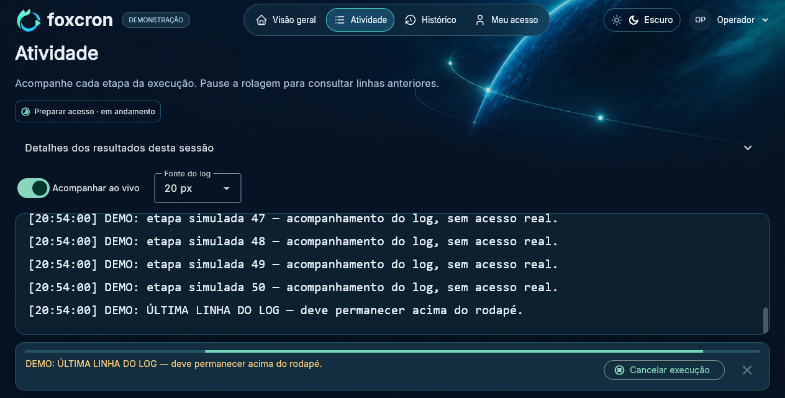
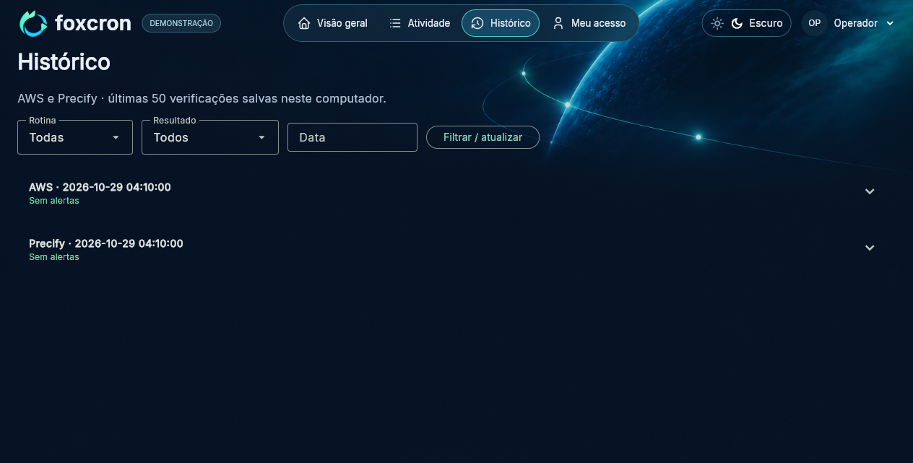

# Guia de operação

## Preparar o turno

Abra o Foxcron com seu usuário Windows e confira seus cadastros em **Meu acesso**. A origem AWS selecionada deve ser **Local protegido — modo rápido** ou **Vaultwarden / Bitwarden**, conforme seu cadastro. Os campos públicos salvos carregam automaticamente; senhas protegidas são indicadas nos campos, sem expor seus valores.

O cadastro **Precify** é único: URL de login, usuário e senha. Ao editar os demais campos e salvar com a senha vazia, a senha protegida existente é reutilizada. O fluxo atende ao ambiente PAGUEMENOS e ao cliente Pague Menos.

## Executar AWS

Na **Visão geral**, clique em **Executar AWS**. Quando necessário, o Foxcron autentica no portal com login/MFA da origem selecionada e confirma a sessão antes de consultar os serviços.

| Dado | Regra de leitura |
| --- | --- |
| CloudWatch | Stream confirmado para o dia operacional em UTC−03:00; pesquisa de ofertas futuras inicializadas com sucesso |
| CPU | Métrica CPUUtilization do RDS, média de 60 segundos e amostra recente válida |
| SQS | Mensagens disponíveis aproximadas nas cinco filas configuradas; zero é OK e valor positivo gera alerta |

CloudWatch, CPU e o bloco SQS são consultados em paralelo; as filas são consultadas em sequência. Uma falha de leitura pode permitir que as demais verificações continuem, mas o resultado geral fica incompleto. Credencial inválida/expirada impede novas chamadas que dependam dela.

Stream do dia ausente não é substituído automaticamente pelo de ontem. Se a automação do dia ainda não rodou, o resultado pode ser inconclusivo; execute novamente no horário operacional correto. Ausência de eventos só significa “Nenhuma oferta futura para inicializar” após uma consulta válida concluída.

## Executar Precify

Clique em **Executar Precify**. O aplicativo entra no backoffice, seleciona PAGUEMENOS e acessa o cliente Pague Menos. Em seguida:

1. Verifica os lotes em processamento; quantidade igual ou superior a 10 gera atenção.
2. Percorre os formatos de impressão listados e identifica conteúdo com “bloqueado”.
3. Fecha as janelas dos formatos sem salvar alterações.

Falha ao ler algum formato ou confirmar cobertura deixa a verificação incompleta. Não considere formatos não lidos como aprovados. A rotina mantém suas regras específicas para ausência do indicador de lotes; o detalhamento aparece em Atividade.

AWS e Precify são independentes, mas somente uma rotina é executada por vez.

## Atividade e cancelamento



- As etapas mostram preparação de acesso, consultas e conclusão. CloudWatch, CPU e SQS podem estar em andamento juntos; as cinco filas continuam sequenciais. Os tempos exibidos são medidos, sem percentual estimado.
- Expanda **Detalhes dos resultados desta sessão** para conferir as filas SQS, cobertura Precify, bloqueios e resumo. O painel tem rolagem própria.
- **Acompanhar ao vivo** mantém a última linha visível. Desative para ler mensagens anteriores.
- **Fonte do log** permite 14, 16, 18 ou 20 px.
- **Cancelar execução** solicita a interrupção e aguarda as operações em andamento e a limpeza dos recursos. Não é encerramento instantâneo de uma chamada de rede.
- Fechar o aplicativo também solicita encerramento seguro. Aguarde a janela fechar.

O rodapé reserva espaço para progresso, avisos e cancelamento, sem cobrir o log. Avisos de falha/cancelamento ficam disponíveis até dispensar. O log da sessão é limitado às últimas 1.500 mensagens.

## Histórico

**Histórico** reúne AWS e Precify salvos no computador. Filtre por rotina, resultado e data (`AAAA-MM-DD`) e clique em **Filtrar / atualizar**. São exibidas até 50 verificações correspondentes aos filtros. Expanda uma linha para consultar o resumo. Os resultados da sessão atual aparecem nos cartões; os valores de um turno anterior não preenchem automaticamente o relatório atual.

Uma execução cancelada antes de concluir não grava uma verificação concluída. Se a gravação do resultado falhar, o aplicativo informa execução incompleta.



## Relatório de monitoramento

O relatório pertence somente à rotina AWS. Para habilitar **Copiar relatório**, AWS precisa concluir nesta sessão, com quantidade de ofertas e CPU válidas. Alertas por mensagens disponíveis nas SQS não bloqueiam a cópia: as filas não fazem parte do modelo. O alerta permanece nos resultados e no histórico. Executar Precify não gera nem invalida esse relatório.

Exemplo demonstrativo:

```text
Monitoramento concluído

✅ Integrador;
✅ Automação de ofertas futuras: 123.456 registros de 123.456
✅ Motor gerador PDF: Ok
✅ Saída de impressão para cartazes e etiquetas: OK
✅ Serviço de expurgo Banco de dados: Ok
✅ Status performance banco de dados agora: 1.14%
```

A quantidade é repetida nos dois espaços do modelo. Com zero ofertas confirmado, a linha informa **Nenhuma oferta futura para inicializar**. A CPU usa duas casas decimais.

**Os OKs fixos são texto do modelo operacional, não verificações adicionais executadas pelo Foxcron.** Revise o texto antes de encaminhar. Se iniciar AWS novamente, o relatório anterior é invalidado até a nova conclusão. Falha, incompletude ou cancelamento AWS não geram texto de sucesso, inclusive falha de leitura SQS ou de gravação do histórico. A liberação com alerta vale somente para contagens SQS confirmadas.

## Dados locais

| Local | Conteúdo |
| --- | --- |
| `%USERPROFILE%\Foxcron\profiles.db` | Cadastros e histórico SQLite em instalações novas da versão 1.25 |
| `%USERPROFILE%\Foxcron\flet_settings.json` | Preferências públicas: portal, origem, tema e dados públicos do cadastro do cofre |
| `%USERPROFILE%\Foxcron\vault_cli` | Perfis locais da CLI por servidor/e-mail; podem conter sessão/dados sensíveis |
| Cofre de credenciais Windows | Senhas e registros protegidos de acesso local, cofre e SSO |

Se você já usava uma versão anterior, o diretório legado é mantido em vez de criar outro cadastro vazio. Consulte [atualização e compatibilidade](INSTALLATION.md#dados-preservados) para localizar seus dados. A revisão não move pastas nem apaga dados automaticamente.

Não envie essas pastas, banco ou cofre a outros operadores nem os anexe a chamados. Não copie uma instalação autenticada como se fosse um pacote do aplicativo. Credenciais de versões antigas podem existir no banco legado; trate todo o banco como sensível.

Para backup, siga a política da organização. Copiar o SQLite não inclui as credenciais protegidas do Windows e não garante restaurar autenticação em outro usuário/computador.

Pastas de dados de instalações anteriores continuam selecionadas sem movimentação. Consulte [Compatibilidade](COMPATIBILITY.md) para os nomes técnicos preservados.
